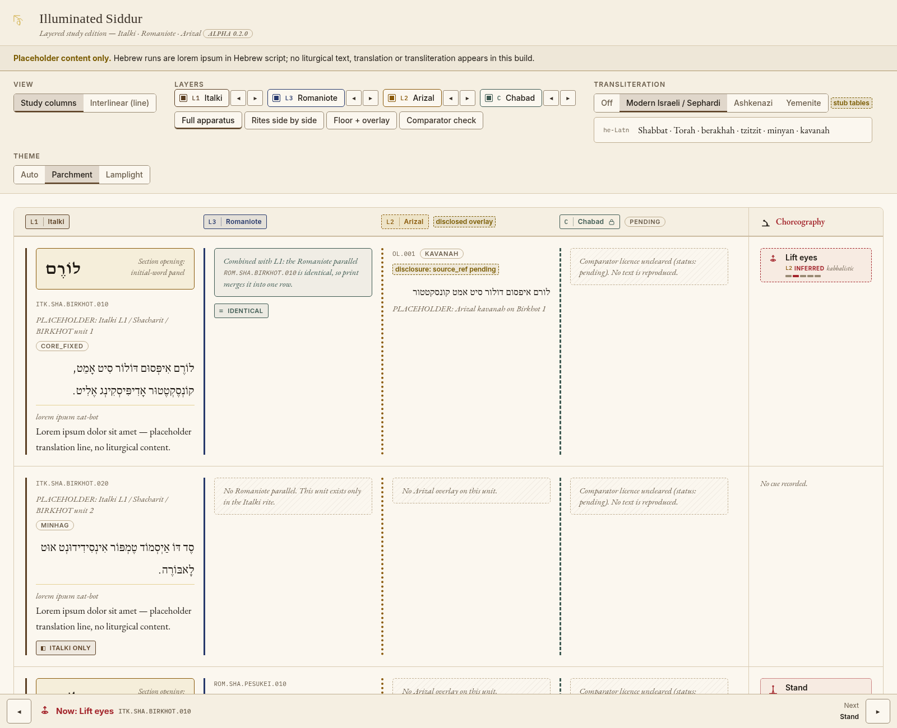
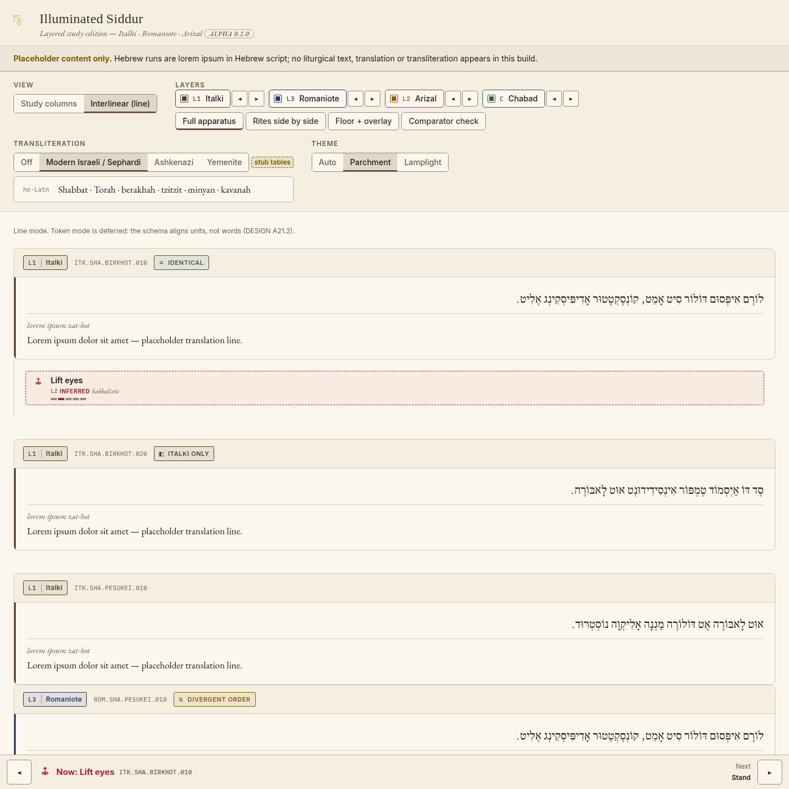
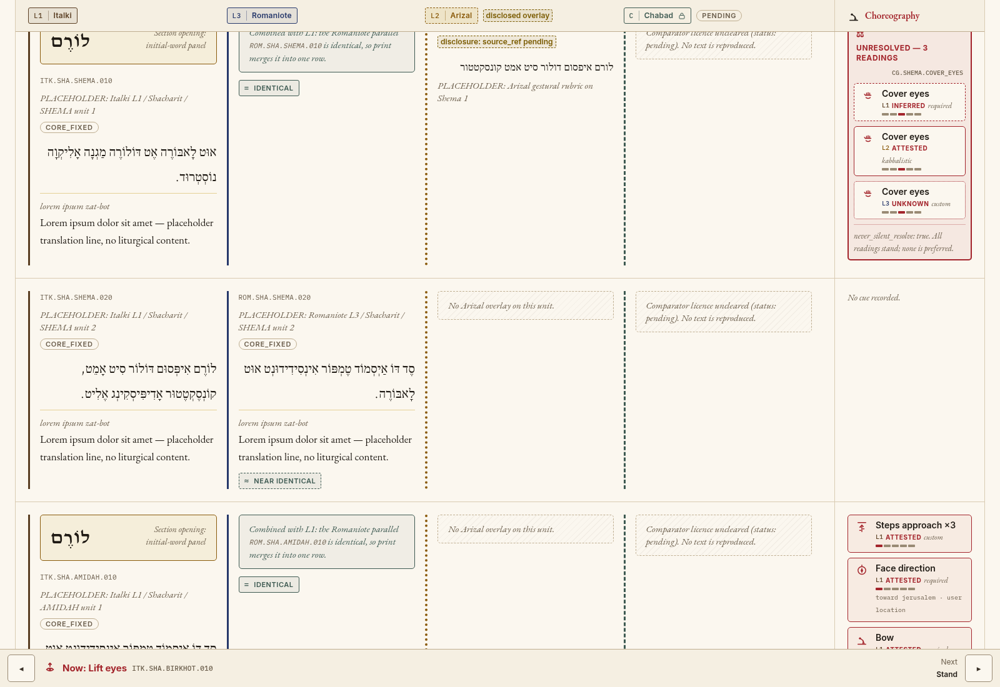
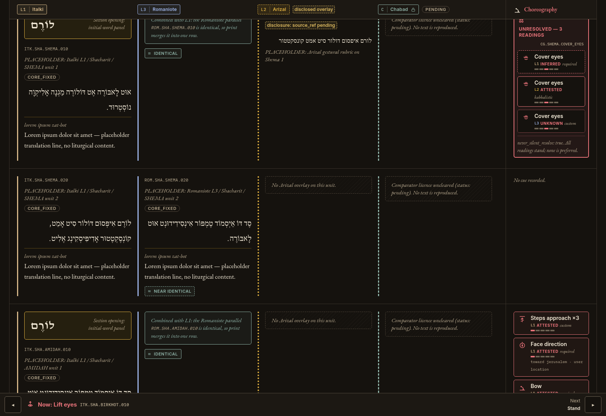
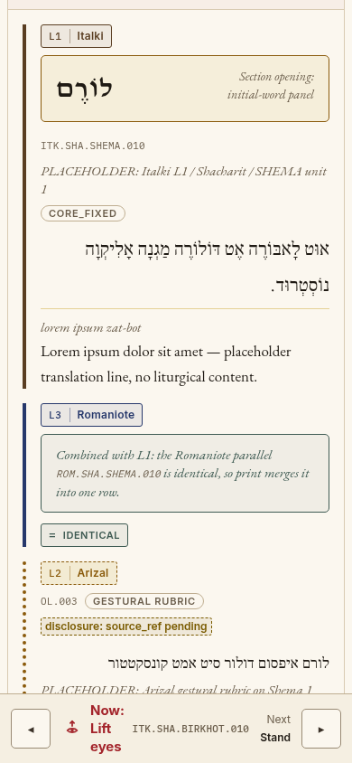

# Illuminated Siddur

**Version: 0.2.0-alpha (alpha mockup).** Illuminated design system applied to the study reader. Design spec: [docs/design/DESIGN.md](docs/design/DESIGN.md).

**This repository holds placeholder content only.** It contains no prayer text in any language. Every unit is a labelled stub such as `PLACEHOLDER: Italki L1 / Shacharit / SHEMA unit 1`.

This is the Phase 0/1 architecture scaffold for a layered siddur study app:
- **L1:** Italki / Benei Roma floor
- **L2:** disclosed Arizal overlays
- **L3:** Romaniote parallel peer
- **Comparator:** Chabad, read-only

See [docs/ARCHITECTURE.md](docs/ARCHITECTURE.md).

## Stack
Vite + React 18 + TypeScript, Vitest, and Ajv for schema validation.

## Run
```bash
npm install
npm run dev      # reader at http://localhost:5173
npm test         # merge, transliteration and schema tests
npm run build    # type-check + production build
node src/seed/build-seed.mjs   # regenerate the placeholder seed JSON
```

## Layout
- `schema/siddur.schema.json`: JSON Schema for the data model
- `src/model/types.ts`: TypeScript types
- `src/seed/`: skeleton weekday Shacharit (IDs and labels only)
- `src/merge/`: alignment and print-merge logic
- `src/translit/`: pluggable transliteration engine (stub tables)
- `src/ui/`: minimal reader
- `tests/`: Vitest suites

## Alpha mockup (0.2.0-alpha)

What the alpha shows, all on placeholder content:
- Parchment (light) and Lamplight (dark) themes from design tokens, self-hosted fonts, no CDN.
- Layer channels on every cell: solid for the L1/L3 floors, dotted for the L2 overlay, dashed for the comparator.
- Layer badges with tier marks, diff chips (glyph + word + colour), and conflict groups that can be expanded but never dismissed, with all sides at equal weight.
- Study mode with reorderable, hideable columns (`◂ ▸` buttons, WCAG 2.2 SC 2.5.7) and presets.
- Interlinear line mode. Token mode is deferred until the schema has word-level alignment.
- Choreography rail with the SVG cue icons; confidence shown as frame style, timing as a 5-tick strip; a now bar for stepping through cues.
- Transliteration switcher: Off, Modern Israeli / Sephardi (default), Ashkenazi, Yemenite, marked `stub tables`.
- Container-query mobile layout; cells stack into cards and the rail goes inline.
- Cue vocabulary migration: `steps_approach`, `steps_retreat`, `face_direction`, `hand_position`, plus new `kneel`, `turn`, `lift_eyes`, `strike_chest`. Facing is data (`direction`), not an enum value.

Deep links: `?view=interlinear`, `?theme=dark`, `?translit=off`.

| Study mode | Interlinear |
| --- | --- |
|  |  |
| **Rail: cover_eyes conflict** | **Dark (Lamplight)** |
|  |  |

Mobile (390px):


